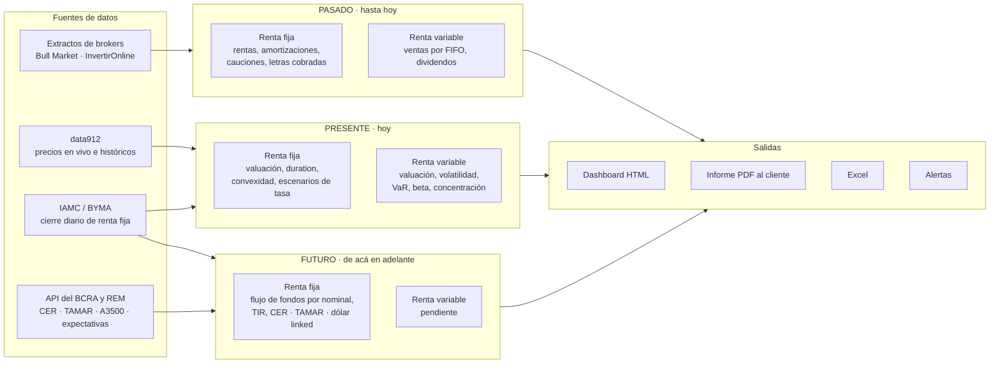

# Mapa del proyecto

Guía para quien llega al repositorio por primera vez, por ejemplo el área de sistemas de Boston.
Responde tres preguntas: qué hace cada parte, dónde está y en qué rama trabajar.

La herramienta mira la cartera de cada cliente en tres tiempos. Son los mismos tres tiempos del
informe que recibe el cliente ([INFORME.md](INFORME.md)):

| Tiempo | Pregunta que responde | En el informe |
|---|---|---|
| **Pasado** | ¿Cuánto gané hasta hoy? | "Lo que ya ganaste" |
| **Presente** | ¿Qué tengo hoy, cuánto vale y cuánto riesgo corro? | "Tu cartera hoy" |
| **Futuro** | ¿Qué me va a pagar desde hoy cada título? | "Lo que vas a ganar desde hoy" |

Cada tiempo se divide en **renta fija** (bonos, obligaciones negociables, letras, cauciones) y
**renta variable** (acciones y CEDEARs).



## Biblioteca de renta fija

Desde el 25/11/2026, **Cartera → Fixed Income Toolkit 0.2.0**, instalado desde
GitHub privado con versión fija. El Toolkit contiene cálculos y fuentes públicas
de renta fija, sin clientes; nunca importa Cartera. Cartera conserva carteras,
lotes, precios manuales, archivos en `--datos`, flujo por cliente, informe, riesgo,
alertas y dashboard. `iamc.py` permanece acá por su cobertura de acciones y CEDEARs.
Los módulos finos mantienen la API española de [CONTRATO.md](CONTRATO.md).
Mapa de nombres, traslado y pruebas: [SEPARACION_RENTA_FIJA.md](SEPARACION_RENTA_FIJA.md).

## Las tres áreas del código

Los módulos están en `src/cartera/`. Los comandos se corren con
`PYTHONPATH=src python3 -m cartera --datos RUTA <comando> --cliente SLUG` (ver [README](../README.md)).

### 1. Pasado: ganancia realizada y tenencia

Reconstruye desde los extractos qué compró y vendió el cliente, cuánto cobró y cuánto ganó o perdió.

| Módulo | Qué hace | Comando | Especificación |
|---|---|---|---|
| `punto_partida.py`, `almacenamiento.py` | Cartera inicial desde Excel y corrección de costos con historial | `importar`, `actualizar-costos` | [FORMATOS.md](FORMATOS.md) |
| `_historial_lectura.py` | Lectura de extractos de Bull Market e InvertirOnline | — | [HISTORIAL.md](HISTORIAL.md) |
| `_historial_calculos.py`, `historial.py` | Lotes por FIFO, ventas, rentas, dividendos, cauciones, capital devuelto | `historial`, `derivar-base` | [HISTORIAL.md](HISTORIAL.md) |
| `dia_cero.py` | Foto inicial de cantidades, precios y efectivo | `fijar-dia-cero`, `efectivo-dia-cero` | [DOMINIO.md](DOMINIO.md) |
| `movimientos.py`, `movimientos_resultados.py` | Operaciones posteriores al día cero y resultado en pesos | `movimiento`, `estado` | [DOMINIO.md](DOMINIO.md) |

**Renta fija:** las amortizaciones parciales son capital devuelto, no ganancia; las letras y los títulos de
un solo pago cierran la posición al cobrar. **Renta variable:** ventas por FIFO y dividendos con sus retenciones.

### 2. Presente: valuación y riesgo

Qué tiene hoy el cliente, cuánto vale y cuánto riesgo corre.

| Módulo | Qué hace | Comando | Especificación |
|---|---|---|---|
| `precios.py`, `transporte.py` | Precios por panel de data912, caché e historial | `capturar` | [PRECIOS.md](PRECIOS.md) |
| `calculos.py` | Valuación de las posiciones | `estado` | [DOMINIO.md](DOMINIO.md) |
| `letras_archivos.py` | Precios manuales de letras, bonos y ON | `letras`, `precio-letra`, `bonos`, `precio-bono` | [LETRAS.md](LETRAS.md) |
| `iamc.py` | Cierre diario de IAMC/BYMA | `iamc` | [FUENTE_IAMC.md](FUENTE_IAMC.md) |
| `riesgo.py`, `_riesgo_calculos.py` | Riesgo por activo y de la cartera completa | `riesgo` | [RIESGO.md](RIESGO.md), [RIESGO_METODOLOGIA.md](RIESGO_METODOLOGIA.md) |
| `alertas.py`, `alertas_comando.py`, `notificar.py` | Avisos por niveles de precio y vencimientos | `alertas` | [ALERTAS.md](ALERTAS.md) |

**Renta variable:** volatilidad histórica y EWMA, VaR y ES, beta contra SPY y aporte de cada activo al riesgo.
**Renta fija:** duration modificada y convexidad del cierre IAMC, con escenarios de ±100 y ±200 puntos básicos.
La metodología está comprobada contra la bibliografía en `tools/riesgo/`.

### 3. Futuro: flujo de fondos y estimaciones

Qué le va a pagar cada título desde hoy, por cada nominal comprado, y a qué rendimiento lo compró.

| Módulo | Qué hace | Comando | Especificación |
|---|---|---|---|
| `flujo_fondos.py` | Flujo por cliente, lotes y separación capital/ganancia; importa cronogramas y TIR del Toolkit | `dashboard`, `flujo` | [FLUJO_FONDOS.md](FLUJO_FONDOS.md) |
| `letras.py` + `financial_engine` instalado | Panel por cliente y motor de letras del Toolkit (LECAP, BONCAP) | `letras` | [LETRAS.md](LETRAS.md) |
| `pagos_indexados.py` | Compatibilidad en español: reexporta pagos indexados del Toolkit | — | [PROYECCIONES.md](PROYECCIONES.md) |
| `indices.py`, `indices_archivos.py` | Compatibilidad con BCRA/REM del Toolkit y gestión de archivos en `--datos` | `indices` | [FUENTE_BCRA.md](FUENTE_BCRA.md) |

**Renta fija:** completa. **Renta variable:** sin proyección todavía; es la próxima área a desarrollar.

### Salidas, comunes a las tres áreas

| Módulo | Qué hace | Comando | Especificación |
|---|---|---|---|
| `dashboard.py`, `dashboard_archivos.py`, `_dashboard_js.py` | Tablero HTML del asesor, con descarga en Excel | `dashboard` | [DASHBOARD.md](DASHBOARD.md) |
| `informe.py` | Informe PDF para el cliente, en lenguaje llano | `informe` | [INFORME.md](INFORME.md) |

## Ramas

Las áreas se separan por carpetas y módulos, no por ramas. Comparten la base del cliente, los precios y el
dashboard, y el informe junta las tres: si cada área viviera en su propia rama, ninguna versión tendría el
programa completo y unirlas cada vez sería un trabajo aparte. Las ramas separan **qué tan probado está** cada
cambio:

| Rama | Qué contiene | Quién la usa |
|---|---|---|
| `main` | Versión estable: pasó todas las pruebas y está aprobada | Producción, lo que se usa con los clientes |
| `staging` | Lo que está listo para que sistemas lo evalúe | Sistemas, antes de pasar a `main` |
| `desarrollo` | Trabajo en curso, puede estar incompleto | Desarrollo diario |

El camino de un cambio es `desarrollo` → `staging` → `main`. Para un trabajo grande, como la renta variable a
futuro, se abre una rama propia desde `desarrollo` (por ejemplo `renta-variable-futuro`) y se une a
`desarrollo` cuando sus pruebas pasan.

## Qué no está en el repositorio

Los datos de los clientes (bases, extractos, precios guardados, informes) viven fuera del repositorio, en la
carpeta que se pasa con `--datos` o con la variable `CARTERA_DATOS`. El código no lleva ningún dato de un
cliente real: las pruebas usan datos ficticios de `fixtures/`. Así el mismo código sirve para cualquier
cliente y los datos se manejan por los canales de la empresa.

## Cómo comprobar que todo funciona

Con Python 3.9, `openpyxl` y `fixed-income-toolkit` instalados (`pip install -r requirements.txt`):

```bash
PYTHONPATH=src python3 -m unittest discover -s tests
```

Son 1027 pruebas y no acceden a la red. El orden de desarrollo y el criterio de cada etapa están en
[PLAN.md](../PLAN.md); las revisiones, en `docs/REVISION_ETAPA*.md`.
